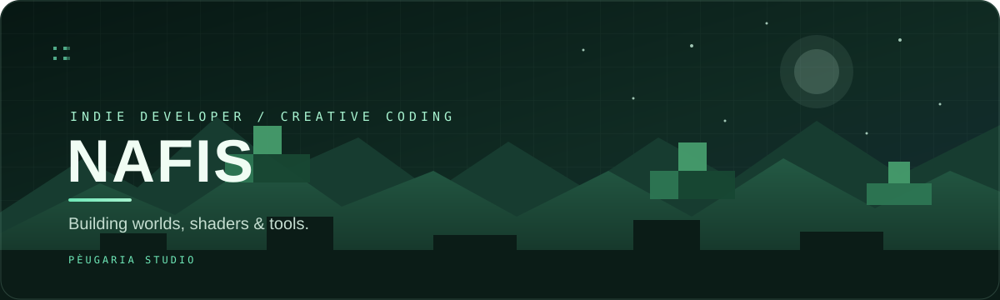

### INDIE DEVELOPER · SHADER CREATOR · MODDING ENTHUSIAST

*Building worlds, shaders & tools — one experiment at a time.*

---

## ◈ PROFILE / OVERVIEW

| **IDENTITY** | **DETAILS** |
|:--|:--|
| Developer | **Nafis** |
| Studio | **PÈUGARIA STUDIO** |
| Main interests | Game development · Real-time graphics · Minecraft modding |
| Current engine | Godot |
| Current focus | Shaders, rendering systems, and Android client modding |

> I learn by building: testing ideas, studying how game systems work, and turning experiments into usable projects.

---

## ◈ FEATURED PROJECTS

| **PROJECT** | **DESCRIPTION** | **FIELD / STATUS** |
|:--|:--|:--|
| **🌊 S.D.V Shader** | A Minecraft visual project focused on atmosphere, water, lighting, and custom effects. | `SHADERS` · `VISUAL FX` |
| **⚙️ Horizon Android Mods** | Experiments expanding native mod capabilities in the Horizon Android client. **[Open repository →](https://github.com/nafisfisszz-create/horizon-android-more-mods)** | `RUST` · `ANDROID` |
| **🎣 FISHING CHIL'S: REBORN** | An indie fishing and exploration game currently in development. | `GODOT` · `GAME DEV` |
| **🧪 Technical Experiments** | Small prototypes exploring rendering, shaders, and game technology. | `R&D` · `PROTOTYPING` |

---

## ◈ DEVELOPMENT TOOLKIT

| **TOOL / TECHNOLOGY** | **AREA** | **FOCUS** |
|:--|:--|:--|
|  | Game engine | Game systems & prototyping |
|  | Programming | Native systems & modding |
|  | 3D | Modeling & asset workflows |
|  | Shading | GPU shader experiments |
|  | Version control | Source management |

---

## ◈ CURRENT EXPLORATIONS

| **RENDERING** | **GAME TECHNOLOGY** |
|:--|:--|
| Real-time shaders and lighting | Minecraft Java / Bedrock customization |
| Water, atmosphere, and visual effects | Android game-client capabilities |
| Environment and visual direction | Game systems and prototyping |

---

| **PÈUGARIA STUDIO** |
|:--:|
| *From a block of an idea to a world of possibilities.* |
| **✦ THANKS FOR VISITING ✦** |

