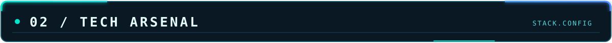

 

**INDIE DEVELOPER · SHADER CREATOR · MODDING ENTHUSIAST**

<code>CREATIVE TECHNOLOGY</code> · <code>REALTIME GRAPHICS</code> · <code>GAME DEVELOPMENT</code>

---

<table width="100%">
<tr>
<td width="50%" valign="top">

**IDENTITY**

- **Name:** Nafis
- **Studio:** PÈUGARIA STUDIO
- **GitHub:** [@nafisfisszz-create](https://github.com/nafisfisszz-create)
- **Role:** Indie Developer

</td>
<td width="50%" valign="top">

**FOCUS AREAS**

- Shader development
- Real-time rendering
- Minecraft modding
- Android game clients

</td>
</tr>
</table>

> Exploring the intersection of creativity and technology. Building visual experiences, experimenting with rendering systems, and developing tools for games.

---

**ENGINE & CODE**

**GRAPHICS & SHADERS**

**MODDING & TOOLS**

---

<table width="100%">
<tr>
<th align="left">PROJECT</th>
<th align="left">DESCRIPTION</th>
<th align="left">CATEGORY</th>
</tr>
<tr>
<td><b>🌊 S.D.V Shader</b></td>
<td>Minecraft shaderpack focused on atmosphere, water, lighting, and visual effects.</td>
<td><code>SHADERPACK</code></td>
</tr>
<tr>
<td><b>⚙️ <a href="https://github.com/nafisfisszz-create/horizon-android-more-mods">Horizon Android Mods</a></b></td>
<td>Native Rust-based mod experiments for the Horizon Android client.</td>
<td><code>RUST / MODDING</code></td>
</tr>
<tr>
<td><b>🎣 Fishing Chil's: Reborn</b></td>
<td>Fishing and exploration game currently in development with Godot.</td>
<td><code>GAME DEV</code></td>
</tr>
<tr>
<td><b>🧪 Technical Experiments</b></td>
<td>Rendering prototypes, shader tests, and technical explorations.</td>
<td><code>R&amp;D</code></td>
</tr>
</table>

---

 

---

DESIGNED & BUILT BY NAFIS

